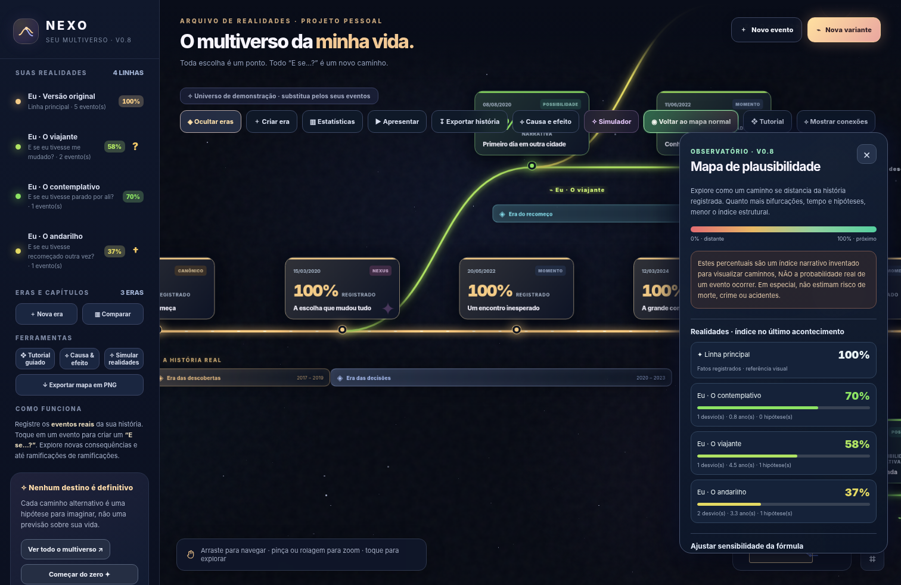
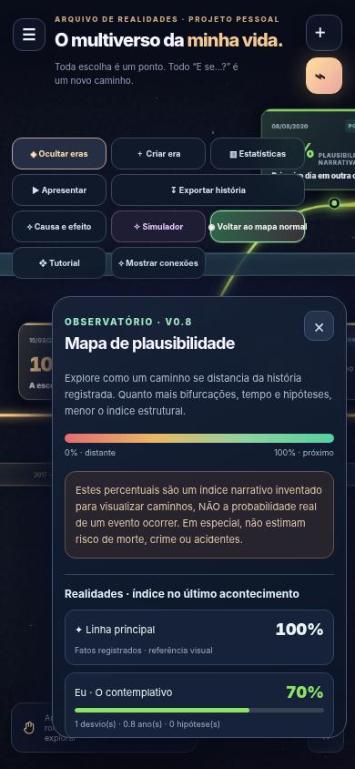

# NEXO — Your Personal Multiverse

**A private visual timeline of life events and alternative “what if?” paths.** Record your actual history, build hypothetical branches, inspect causal connections, and compare imagined realities. No account, build tooling, external AI, or cloud database is required.



## Current release

**NEXO `0.8.0` — Narrative Plausibility Map** · Git tag: `v0.8.0` · HTML + CSS + JavaScript · GitHub Pages ready.

## New in v0.8: narrative plausibility map

Toggle **“◉ Mapa de plausibilidade”** in the toolbar to temporarily switch event cards and branch routes into **percentages with a red → amber → green visual scale**. This can be switched off without modifying any events.

- Each alternate branch displays a **narrative proximity index**, measured relative to the documented primary timeline.
- Event cards show that index; branch paths and labels change color with the index.
- The comparison panel ranks all branches by the index at each branch's last dated event or terminal marker. Select a branch to navigate directly to it.
- Tune three parameters using sliders: divergence penalty, time decay, and penalty per hypothetical event.
- Edit a branch and choose **Mild**, **Moderate**, or **Radical** divergence intensity. A stronger deviation reduces the index more than a mild deviation.
- Export the entire timeline as **PNG while the index mode is on** to include colored paths and percentages.
- The guided tutorial now explains this feature. Existing JSON exports include the optional `plausibility` settings and each branch's `impact` value.



### How the model works

For an alternate timeline, the current index is:

```text
Narrative index = round(
  100 × (1 - forkPenalty / 100) ^ (sum of branch-impact weights)
      × (1 - yearPenalty / 100) ^ yearsSinceFirstDivergence
      × (1 - assumptionPenalty / 100) ^ hypotheticalEventsOnThisPath
)
```

Default values are `forkPenalty = 28%`, `yearPenalty = 4% per year`, and `assumptionPenalty = 3% per event`. Impact weights: mild `0.65`, moderate `1`, radical `1.5`. The displayed index is limited to `1%–99%` for alternate paths and `100%` for the real timeline, which means **recorded history, not a predicted certainty**. Time is counted from the first divergence along the selected path. Descendant branches inherit their ancestor branch penalties. Events outside a path, including sibling branches, do **not** automatically decrease its score.

The index describes **distance from the primary narrative under a user-editable heuristic**. It is **not** a calibrated likelihood, frequency, actuarial model, safety assessment, prediction, or percentage chance of crime, injury, death, or any other personal outcome. More distance from an observed life history does not scientifically imply a smaller chance of a different life event. The default percentages were selected for visualization, not based on population data. Do not use these scores for consequential decisions.

See [FORMULA.md](FORMULA.md) for interpretation, examples, and limitations.

## Features carried forward

- Interactive primary timeline and nested alternate branches, drag/pinch zoom and minimap.
- One-click **continue this timeline** buttons, automatically suggested date, and “Save & Add Next” flow.
- Story identities, named eras/chapters, editable fixed colors, Nexus/Canonical/Moment/Milestone/Achievement/Thought event types, local rule-based type suggestions.
- Editable unknown future (`?`), hypothetical probable-death (`†`), and closed (`■`) terminal markers; these are story labels, **not forecasts**.
- Explicit causal links with warnings about potentially affected events.
- Sandbox reality simulations with independent what-if experiments.
- Step-by-step guided tutorial, normal timeline statistics, presentation/slideshow mode.
- Exports: map as PNG, story as TXT/Markdown/PNG, browser print-to-PDF, simulation reports and full JSON backups.
- Phone and desktop UI; independently scrolling sidebar; entirely local history by default.

## Installation and publishing

**Local:** open `index.html` in a modern browser.

**GitHub Pages:** upload the contents of the ZIP at the **root** of your repository (not within a nested version folder). In **Settings → Pages**, choose **Deploy from a branch**, branch `main`, folder `/(root)`. Typical URL: `https://YOUR-USERNAME.github.io/nexo-personal-multiverse/`.

## Updating from v0.7 or earlier

1. **Export a private JSON backup** from your current installation and keep it outside any public repository.
2. Replace the old root `index.html` with the new one, add the documentation, and replace preview images if desired.
3. Preserve the existing Pages URL. NEXO still reads browser data under the unchanged `nexo-multiverso-v1` key; old branches default to moderate divergence and default index settings.
4. Reload the page; if the browser no longer has data, use Import JSON and restore your backup.
5. Create git tag **`v0.8.0`**, with release title **`NEXO v0.8.0 — Narrative Plausibility Map`**. Publish the notes in `RELEASE_NOTES_v0.8.0.md`.

Suggested commit:

```text
feat: add narrative plausibility map and branching index
```

No database migration, dependencies, or build step is required.

## Privacy and limits

- Personal life histories, exported images, and JSON backups are **private data**. Do not commit them to a public repo. See [SECURITY.md](SECURITY.md) and `.gitignore`.
- Data is stored in `localStorage`, independently in each browser profile and URL. It does **not** automatically synchronize between browsers/devices. Clearing site data can erase it; export backups routinely.
- The index is intentionally **illustrative**. Do not treat alternate-timeline percentages as statistical predictions.
- Larger timelines may exhaust the browser's storage or canvas memory limits when exporting images.

## License and attribution

This repository does not automatically grant third-party reuse rights; add a license if you intend to distribute the code for reuse. Visual branching timelines are presented as a narrative metaphor and NEXO is not affiliated with Marvel or any franchise.
