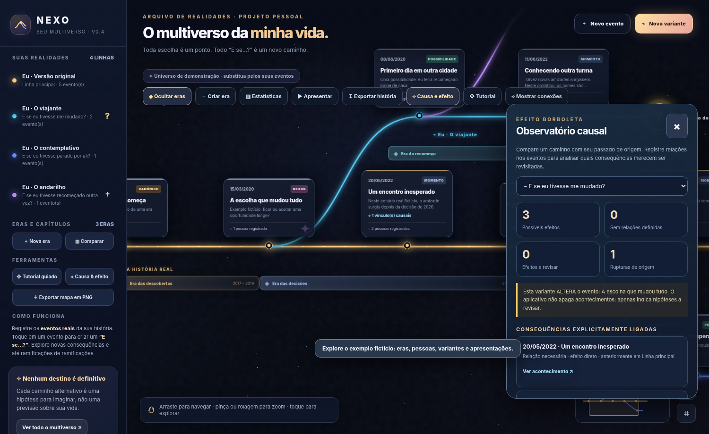

# NEXO — Your Personal Multiverse

A visual, browser-based journal for mapping your life, exploring alternate paths, and recording the consequences of hypothetical decisions. Inspired by the *concept* of branching timelines; not affiliated with Marvel or any other franchise.

## Version

**Current version: `0.4.0`** — *Cause & Effect*

NEXO is a standalone, zero-dependency static website. You can run it by opening `index.html` in a browser or publish it using GitHub Pages.

## What's inside

- **Sacred/main timeline:** Record dated, real-life events, descriptions, people, places, canonical moments, Nexus events, and achievements.
- **Alternative timelines:** Branch from an event, name an alternate persona, customize a branch color, create nested branches, or mark an uncertain ending / hypothetical death / closed path.
- **Eras and chapters:** Organize periods using optional colored labels and descriptions.
- **Cause & effect (new):** Open an event and use **Edit causes and effects** to link earlier events as either a **necessary condition** or **influence**. The causal observatory flags explicitly linked outcomes that could be affected by altered decisions. It never invents or deletes outcomes.
- **Divergence modes (new):** Choose whether a variant *changes the source event* or *begins afterward*. This determines whether the source is considered disrupted in causal analysis. Existing branches imported from older releases default to the safer "begins afterward" setting until you edit them.
- **Connection visualization (new):** Display dotted causal links between events on the map.
- **Guided tour (new):** Nine steps introducing the map, event registration, variants, causal relationships, exports, slideshow, and backups.
- **Scrollable sidebar (fixed):** All sections remain accessible on desktop and mobile.
- **Statistics:** Compare known people, places, achievements, and significant events on different timeline paths. When a variant explicitly changes the source event, that source event's people and places are not automatically considered established in the variant.
- **Slideshow:** Present a timeline as an animated chronological sequence.
- **Narrative export:** Copy or download a written history as `.txt`, `.md`, or a long `.png`; use **PDF / Print** and select *Save as PDF* in the browser print dialog.
- **Map image export (new):** Export the complete visual multiverse as a `.png`, including the current event cards, branches, era bars, and terminal markers.
- **JSON import/export:** Make portable backups of your entire data set and restore on another browser/device manually.

## Quick start

1. Open `index.html` in a current version of Chrome, Chromium, Edge, Firefox, or Safari (GitHub Pages/HTTPS is recommended).
2. Follow the **Guided Tour**. You can replay it from the toolbar or the sidebar.
3. Inspect the fictional example. Select **Start from scratch** in the sidebar to replace it with your own records.
4. Create an event in the main timeline. Add dates, places, people, and descriptions as appropriate.
5. Select the event and create an alternative branch. Determine whether the original event changed or the branch starts after it.
6. To record dependency, open a subsequent event and choose **Edit causes and effects**. Only earlier events from its timeline history are eligible.
7. Open **Cause & Effect** and choose a variant to inspect possible affected outcomes. Enable **Show Connections** to see relationships visually.
8. Export a **JSON backup** regularly. Narratives, prints and map PNGs are additional exports, *not backups*.

## How the causal model works

Suppose the main timeline records:

- 2020: A decision to remain in a city.
- 2022: Meeting a friend, registered as **dependent on** the 2020 decision.
- 2024: Achieving a personal goal, registered as **influenced by** the 2022 meeting.

If you create a variant that *changes the 2020 decision*, NEXO highlights the 2022 event as a possible direct effect and the 2024 event as a possible downstream effect. Events registered **without causal links** are classified as simply outside that inherited timeline. Neither category represents proof that something definitely would or would not have happened.

**Important limitations:**

- All causal links are authored by the user; NEXO does not predict timelines.
- An existing alternative timeline includes the original fork event as historical context; if you mark its source as altered, its people/places do not count as guaranteed encounters in the variant.
- The causal observatory compares a nested branch against its immediate parent trajectory and also accounts for altered forks inherited from earlier branches. No events are removed automatically.
- Events occurring on the same date cannot be causally linked through the current editor; assign distinct days if sequential ordering matters.
- Extremely large multiverse PNG exports can exceed the browser's canvas limits.

## GitHub Pages deployment

1. Create a repository, for example **`nexo-personal-multiverse`**.
2. Upload all project files, keeping `index.html` at the repository root.
3. In **Settings → Pages**, select **Deploy from a branch**, your `main` branch, and `/(root)`.
4. After Pages has deployed, visit `https://YOUR-USERNAME.github.io/nexo-personal-multiverse/`.

Do **not** upload personal JSON backups or exported personal narratives. The files in this repository are application code and fictional preview illustrations only.

## Updating from v0.3.x

1. **Export a JSON backup in the old version before updating.**
2. Replace `index.html`; add the documentation and asset files from this release.
3. Keep using the **same GitHub Pages URL** and browser to access locally stored data.
4. If necessary, import your JSON backup through the NEXO interface.
5. Existing timelines, eras, endings, personas, and narrative exports remain supported. Earlier branches default to *starts after source event* until you explicitly change the divergence mode.

Version updates may be cached by your browser. Reload/refresh the page after a deployment.

## Data privacy and storage

NEXO currently uses the browser's `localStorage` (`nexo-multiverso-v1`). There is **no account system, cloud database, or synchronization**. Each browser profile stores its own data. Clearing site data or using another device without importing a backup may result in data loss.

- Users are responsible for backups.
- Treat exports and JSON backups as highly personal information. They are **not encrypted**.
- NEXO does not require API keys, third-party CDNs, analytics, or cloud services.
- GitHub Pages publishes the app files, **not** data stored locally inside visitors' browsers.

## Technical architecture

Single-file HTML / CSS / vanilla JavaScript. Interactive timeline paths use SVG; map image export uses Canvas 2D; PDF is created via the browser's native print-to-PDF capability. No server, database, build pipeline, or external dependencies are required.

## Roadmap ideas

- Editable causal graphs, confidence indicators, and uncertainty controls
- Exporting just one selected visual timeline (rather than the whole map)
- Extended cinematic timeline transitions
- Portable encrypted backups and optional cloud sync
- Choice-driven "What If?" narrative RPG

## Changelog and security

See [`CHANGELOG.md`](CHANGELOG.md), [`RELEASE_NOTES_v0.4.0.md`](RELEASE_NOTES_v0.4.0.md), and [`SECURITY.md`](SECURITY.md).

---

NEXO is a personal storytelling and reflection tool. It is **not** a scientific prediction system or professional mental health assessment.
