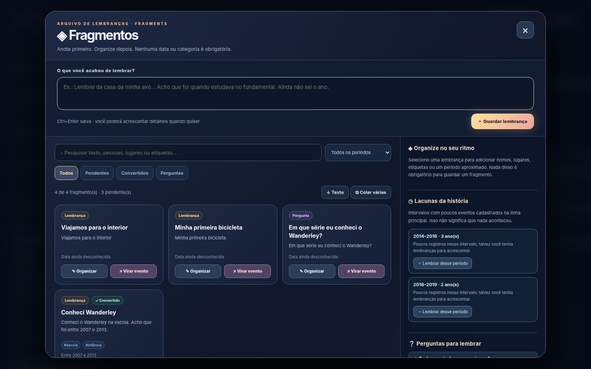
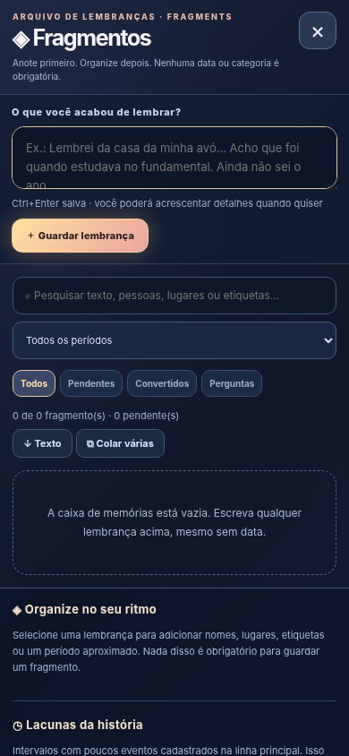
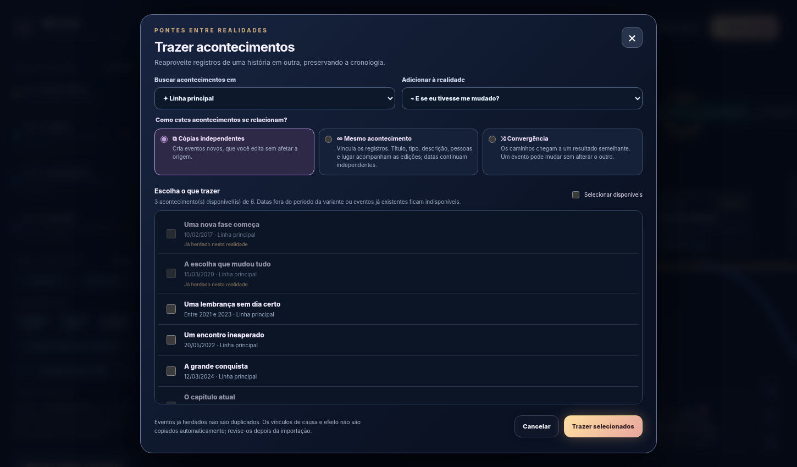
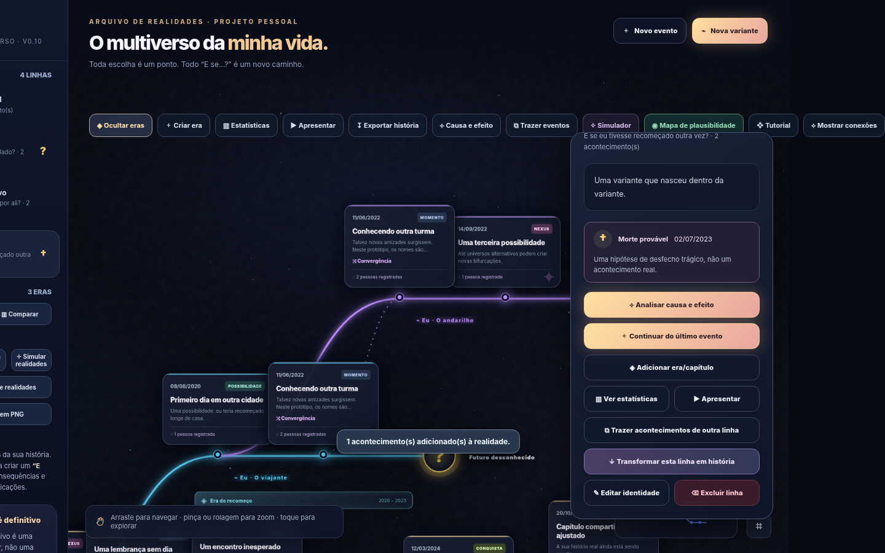
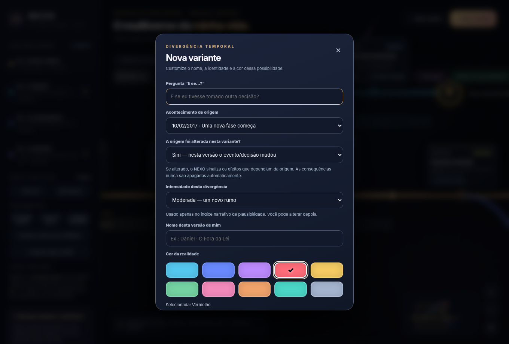

# NEXO — Your Personal Multiverse

**An interactive timeline of real memories, divergent histories, and personal “what if?” scenarios.** NEXO runs as a single static HTML file, with no external AI, backend, or required cloud account.

**Release:** `0.11.0` · **Git tag:** `v0.11.0` · **Hosting:** GitHub Pages or any static file host · **Language:** Brazilian Portuguese.

## New in v0.11 — Fragments: Memory Inbox

**Capture first, organize later.** NEXO now features a personal inbox for memories, open questions and ideas that are not ready to become timeline events. Open **◈ Fragmentos** from the timeline toolbar or sidebar (or **Lembrar** on desktop). Type anything you remember and save it **without a date, category, or timeline**.

### Features

- **Rapid capture** with keyboard shortcut `Ctrl+Enter` / `Cmd+Enter` inside the quick-capture field. Captures are initially pending.
- **Personal organization:** optional title, freeform content, people, place, comma-separated tags, and three kinds (`memory`, `question`, `idea`). Supported dating: unknown, exact date, month, year, or a range of years.
- **Search and filters:** case/accent-insensitive search across body, title, people, place and tags; filter pending, converted or questions, and dated or undated records.
- **Non-destructive event conversion:** **Virar evento** opens the existing event editor with the fragment's title, text, people, place and optional temporal precision prefilled. Nothing is removed from the inbox. The created event is linked to its source fragment via `sourceFragmentId`, while the fragment stores `eventId`.
- **Unknown-date guardrail:** undated fragments require an explicit review confirmation in the event editor. **The existing editor initially displays today's date as a UI default, not as a derived fact.** Choose the correct date or an available approximate range before confirming. If you still cannot assign a date or range, keep the note as a fragment instead.
- **Open questions and gap prompts:** a deterministic list of reflection questions plus year gaps between recorded **main-timeline** events. Gaps mean *limited coverage*, **not** that nothing happened or that the person has forgotten those years.
- **Bulk capture:** paste up to 100 one-line memories per import; exact duplicate lines are skipped (accent-insensitive).
- **Plain-text export:** export the fragment inbox to `.txt` for archival and editing.
- **Private backup:** all fragments are included automatically in the existing full JSON backup. Upgrading older backups adds an empty `fragments` array without modifying existing event data.

### Limits and deliberate safeguards

- Up to 1,000 fragment records in the local data envelope; quick capture and import require text. Each note is up to 5,000 characters (subject to browser storage quota).
- Dates in the memory inbox are **your estimates**. NEXO neither verifies them nor predicts details.
- A fragment converted to an event remains in the inbox. Removing that event makes the fragment pending again; deleting the fragment does not delete the linked timeline event.
- If you import records from an older version, existing branches, events, sims and eras remain compatible. Back up before updating in all cases.
- NEXO remains static/offline-capable after load, but its local data is **not encrypted**, synced, or protected from someone with access to the browser profile. See [SECURITY.md](SECURITY.md).

## Previous release: v0.10 — Shared Events & Semantic Branch Colors

### Three ways to bring an event into another reality

Open **Trazer eventos** from the toolbar/sidebar, or select an event and choose **Copiar / compartilhar com outra linha**. Choose a source timeline, a destination timeline, one or more events, and one import behavior:

| Behavior | What it means | What happens when edited |
|---|---|---|
| **Independent copy** | Similar event occurs in the destination; no permanent shared record | All changes remain local to that copy |
| **Same event / shared** | The event is considered to have occurred in both realities | Title, type, description, people and place stay synchronized between linked records; **dates and causal dependencies remain independent** |
| **Convergence** | Different paths reach similar outcomes | Independent event details, but a recorded and visually displayed convergence link |

The timeline draws **cyan dashed links** for shared occurrences and **purple dotted links** for convergences. Event cards carry corresponding labels. You can unlink an occurrence from its details panel without deleting it. Copies and links are represented by optional metadata (`copiedFromId`, `sharedGroupId`, `convergenceGroupId`) in the usual event records.

**Safety and chronology:**

- The app automatically excludes events already inherited at the divergence point or previously imported from the same source (root event ID).
- A destination branch only accepts events whose entire known/possible occurrence window falls **after its origin** and, when there is an explicit ending date, **before its ending**. Uncertain dates with overlapping windows cannot be placed confidently across the boundary and are excluded.
- Original event records are never removed by copying/importing.
- New copies **do not copy causal links**, since the causal conditions in an alternative reality may differ. Add the destination's causal dependencies manually if appropriate.
- Syncing a shared event edits common descriptive fields in its linked copies; this is an intentional **bidirectional** effect. Unlink first if you want independent descriptions. An event's place/person details are potentially sensitive.
- Importing between timelines is an authoring operation; it does **not** calculate a future probability or establish that the event was inevitable.

### Semantic color guide

The branch editor now includes a **Guide to colors**, with a named fixed palette and optional interpretations:

| Color | Narrative suggestion |
|---|---|
| Ocean blue | Neutral alternatives / ordinary life |
| Royal blue | Learning, plans, opportunity |
| Purple | Identity, introspection, mystery |
| Red | Adversity, loss, danger or negative paths |
| Yellow | Uncertainty, decisions, open possibilities |
| Green | Achievement, healing, personal growth |
| Pink | Love, romance and dating |
| Orange | Adventure, major changes, impulsiveness |
| Turquoise | Friendship, family and support |
| Lunar gray | Distance, colder periods, solitude or uncertain tone |

These color meanings are **suggestions only**, never judgments or predictions. Branch color does not affect calculated narrative plausibility, terminal state, or event classification.

### Friendlier editor forms

Inline help now explains **Event description and repercussions**, **Description of this alternate reality**, **Current branch state**, **Endpoint date**, and **Endpoint note**. Endpoint date/note are only displayed for closed/unknown/hypothetical-death branches. **First event of this variant is now optional**; leave it blank and use **Continue this timeline** later.

The guided tutorial now includes importing shared events and semantic colors.

## Other features retained

- Five supported event date precisions: exact day, month/year, year, between years, between dates. Uncertain time windows are displayed as dashed spans without inventing a specific day.
- Chronological reflow, same-line continuation, named eras, personas, endings and local event categorization suggestions.
- Explicit cause-and-effect relations, simulator experiments, narrative plausibility view (illustrative only), story slideshow and statistics.
- PNG exports of the map and written stories, TXT/Markdown story exports, print-to-PDF and full JSON backup/restore.

See [FORMULA.md](FORMULA.md) for limitations of the narrative plausibility index.

## Installation / GitHub Pages

1. Download and extract the release archive. Upload its **contents** (not the outer folder) into the root of your GitHub repository, including `index.html`, `README.md`, the release docs, and `assets/`.
2. In GitHub: **Settings → Pages → Deploy from a branch**, select `main` and `/ (root)`. GitHub Pages will serve the root `index.html`.
3. Suggested repository name: `nexo-personal-multiverse`. Typical URL: `https://YOUR-USERNAME.github.io/nexo-personal-multiverse/`.
4. Alternatively, open the `index.html` file directly in a compatible browser. Storage behavior depends on the browser and page origin.

## Upgrading from v0.10.0 or earlier

1. Open your existing app and **export a JSON backup**, storing it privately and outside public source control.
2. Replace the root `index.html` and refresh your documentation/assets.
3. Keep the **same Pages origin/URL** where possible: browser-local data is tied to the origin, not to your GitHub account.
4. Refresh and verify existing events/branches/eras/simulations. If necessary, restore using **Import JSON**. An existing `version:1` data envelope is supported.
5. Create tag `v0.11.0` and a release titled **NEXO v0.11.0 — Fragments: Memory Inbox**.

Suggested commit: `feat: add fragments memory inbox and guided event conversion`

## Privacy and known limitations

NEXO saves history to browser `localStorage` under the existing key `nexo-multiverso-v1`. There is no automatic device synchronization, encrypted cloud backup, account login, or server-side recovery. Clearing browser storage can erase personal data; use JSON backups regularly. Backups, narratives and images are **not encrypted**. Never upload real personal history exports or API credentials to a public repository. Read [SECURITY.md](SECURITY.md).

The app is a personal storytelling and reflection tool, **not** a system for predicting death, crime, relationships or future events. The narrative plausibility percentage is illustrative, not a measured probability. A branch's red color also does not imply any factual likelihood of harm.

## Project and attribution

NEXO is a personal software experiment, not affiliated with Marvel or any entertainment franchise. No reuse license has been granted by default; add a license when you decide how other developers may reuse the source.
