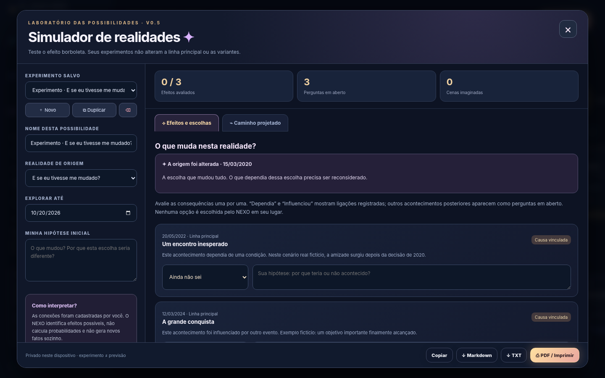
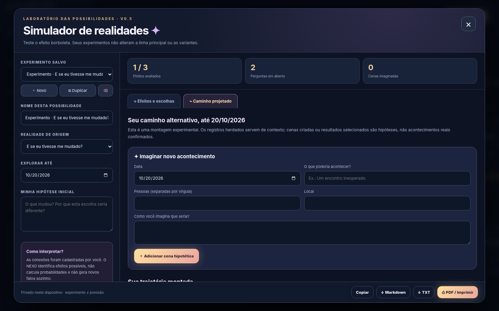
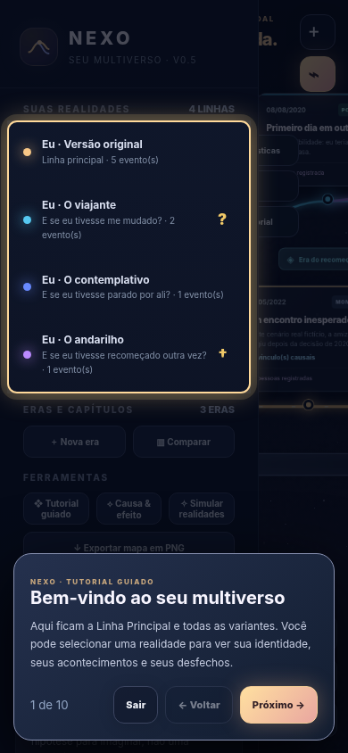

# NEXO — Your Personal Multiverse

A visual, private, browser-based life timeline for exploring **what-if** questions. Track real moments on a primary timeline, branch into alternate lives, connect events through cause and effect, and explore how different choices *might* change later chapters. The branching-universe aesthetic is a storytelling motif; NEXO is not associated with Marvel or another franchise.

## Release

**Version `0.5.0` — Reality Simulator** | Tag: `v0.5.0` | No build tools, API keys, accounts, databases, or external dependencies.

Open `index.html` locally or publish these files on **GitHub Pages**. Each browser stores its own private data locally via `localStorage`.

## New in 0.5.0

### Reality Simulator (new)

1. Create at least one alternate timeline by branching from a dated event.
2. Open **Reality Simulator** from the toolbar or sidebar. A new experiment is created for your selected branch (or choose an existing one).
3. Name your experiment, choose its alternate timeline, set the last date you want to explore, and describe the hypothetical change.
4. Under **Effects & Choices**, review events missing from the inherited timeline or flagged by the causal model. Mark individual outcomes as **Unknown**, **Would still happen**, **Would not happen**, or **Would happen differently**. Add your own reasoning for each event.
5. Under **Projected Path**, view the chronological story assembled from the inherited record, events already on the alternative timeline, decisions made inside the experiment, and your manually created hypothetical scenes.
6. Save multiple experiments for the same branch, duplicate or delete them without changing actual events. All edits save locally and are included in JSON backup.
7. Copy or export the scenario as TXT, Markdown, or use the browser's **Print / Save as PDF** function.

**Important:** This is an interactive, rules-based hypothesis organizer **without generative AI**. It does not create new life events automatically, compute likelihoods, or tell you what would actually have happened. A dependency is an author's assumption, not a scientific prediction. Statements such as “would not happen” are choices made **inside that experiment only**.

### Guided tour (fixed)

- Ten steps including the new simulator.
- The old full-screen blur has been replaced with a spotlight that dims only the area outside the indicated UI element.
- The spotlight updates after the mobile sidebar's opening animation, rather than remaining positioned over its old location.
- Mobile experiments offer a collapsible setup area so the scenario results are visible sooner.
- Replay the tour from the toolbar or sidebar. Existing completion of the v0.4 tour is respected.

## Existing features

- **Primary timeline** for real events: dates, descriptions, people, places, canonical moments, Nexus events, and personal achievements.
- **Alternate branches**, including branches off other branches, with individual names, persona identities, colors and hypothetical endings (unknown future / likely death / closed / open).
- **Eras and chapters** with time ranges and descriptions.
- **Cause & Effect Observatory**, where earlier events may be declared *necessary* or *influential* for later events. An altered fork highlights connected outcomes for review, including downstream links. The model never automatically deletes records.
- **Visual causal links** as optional dotted lines.
- **People/place statistics** reflecting recorded events and inheritance at the fork date.
- **Presentation mode** to play through the recorded events in a selected timeline.
- **Story exports:** TXT, Markdown, tall PNG image, and browser printing to PDF.
- **Full multiverse map PNG export**, including event cards, colored branches, eras, and terminal markers.
- **Portable JSON backup and restore** for all timelines, eras, causal links, endings, and simulator experiments.

## Running locally or on GitHub Pages

1. Download this release ZIP and unzip it.
2. Double-click `index.html` to start using NEXO. GitHub Pages over HTTPS is recommended for consistent browser storage and exporting.
3. To publish, create a repository named, for example, **`nexo-personal-multiverse`**, and upload everything in the ZIP while keeping `index.html` at the root.
4. Go to **Repository Settings → Pages → Build and deployment → Deploy from a branch**, choose `main` and `/(root)`.
5. Visit `https://YOUR-USERNAME.github.io/nexo-personal-multiverse/` once Pages has finished deploying.

**Do not upload personal export files to a public repository.** Your browser's local records are not deployed with the static website.

## Updating from 0.4.x (and earlier)

1. In the old version, click **Backup**, save its JSON file, and keep an additional copy outside the repository.
2. Replace the previous `index.html` with the one in this release; also update documentation and screenshots.
3. Keep using the **exact same GitHub Pages URL and browser profile** to retain browser-local data. The storage key remains `nexo-multiverso-v1`, with backward-compatible hydration of older objects.
4. If the browser lost its local data, use **Import** to restore the exported JSON file.
5. Refresh the page after deployment. If a cached release remains, hard-refresh/reopen the tab.

**Version 0.5.0 adds** an optional `simulations` array to the JSON structure; older data loads with `simulations: []` and continues to work.

## Storage, privacy, and limits

- Local data is stored in browser **localStorage**; there are **no accounts, cloud sync, server APIs, trackers or analytics**.
- Clearing browser site data, changing the site URL/origin, switching devices, or using private browsing can cause data loss. Export and safely store **JSON backups** often.
- Exports can contain sensitive personal information and are **not encrypted**; treat them as private documents.
- The simulator runs on your own causal links and manual assumptions, not a trained model or a probability engine.
- No AI inference, external web search, PDF service, image hosting service, or online content uploads occur.
- Large maps may exceed browser image export memory limits. Use narrative text or partial exports where applicable.
- GitHub Pages is static hosting. Multi-device sync would require optional backend development in a future release.

## Technical architecture

Single-file HTML, CSS, and vanilla JavaScript. SVG-based timeline, Canvas PNG export, browser-native PDF printing, client-side data persistence, no build pipeline.

The simulator persists a collection of `{ id, branchId, name, until, premise, answers, scenes }` objects; event identities and causal references are reused rather than duplicated in user data. Scenario responses and scenes **never mutate** the timeline's event collection.

## Repository versioning

- Suggested repository: `nexo-personal-multiverse`
- Current release tag: **`v0.5.0`**
- Release title: **`NEXO v0.5.0 — Reality Simulator`**
- Conventional commit: **`feat: add reality simulator and fix guided tour spotlight`**
- See [`CHANGELOG.md`](CHANGELOG.md) and [`RELEASE_NOTES_v0.5.0.md`](RELEASE_NOTES_v0.5.0.md).

## Roadmap ideas

- Optional AI-assisted suggestions with explicit consent and clear confidence/uncertainty labeling
- Per-simulation charts for changes in acquaintances, places and achievements
- Interactive choice-based RPG mode / convergence comparison
- Stronger backups, encrypted archives, opt-in cloud sync
- Improved accessibility, keyboard navigation, larger-scale performance

## License

No open-source license is included with this release. The project owner can choose an appropriate license before inviting public contributions or redistributing modified versions.
