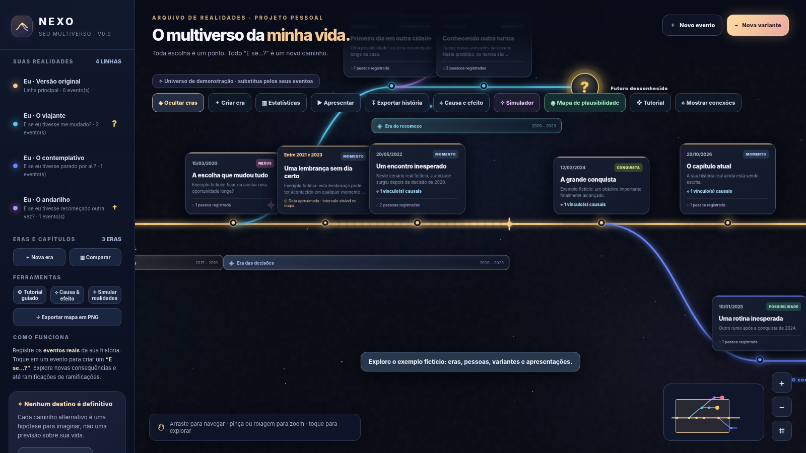
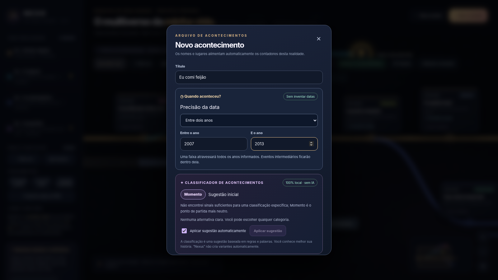
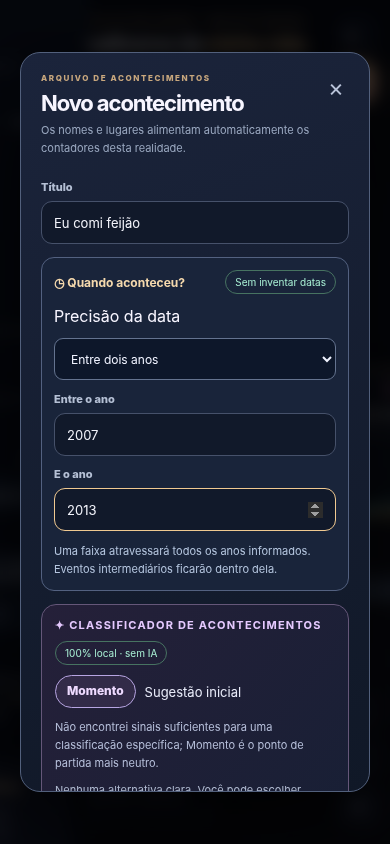

# NEXO — Your Personal Multiverse

**An interactive life timeline for memories, alternate paths, and “what if?” stories.** Build a real-life history, branch it into alternate scenarios, record people and eras, explore cause-and-effect connections, and export narratives.



**Release:** `0.9.0` · **Tag:** `v0.9.0` · **Stack:** single static HTML file with embedded CSS and JavaScript · **Hosting:** GitHub Pages · **Cloud/database:** none required.

## What's new in v0.9 — approximate event dates

You can save an event without making up an exact calendar date. In the event editor, select:

| Date mode | Example shown on your timeline | Meaning |
|---|---|---|
| Exact day | `14/08/2002` | Known date |
| Month and year | `agosto de 2002 (dia incerto)` | Could have happened at any point in that month |
| Year only | `Em 2006 (dia e mês incertos)` | Could have happened at any point in the year |
| Between years | `Entre 2007 e 2013` | Could have happened at any point in these inclusive years |
| Between dates | `Entre 14/08/2007 e 03/12/2013` | Could have happened at any point inside the inclusive date interval |



**Visual behavior:** an uncertain event gets a dashed marker and a range segment with an ending marker. It is anchored at the **earliest possible day**, strictly for display. Its line extends through the **latest possible day**. The label never claims it occurred on that first day.

When a new dated event is added between the boundaries (for example, an event in 2010 inside a `2007–2013` range), the timeline automatically introduces an intermediate position and redraws the interval across that new event. This is a visual overlap, **not a claim that the uncertain event preceded or caused the 2010 event**.

### Data semantics

```json
{
  "id": "example",
  "lineId": "main",
  "title": "An uncertain memory",
  "date": "2007-01-01",
  "time": {
    "precision": "range-years",
    "start": "2007-01-01",
    "end": "2013-12-31"
  },
  "type": "moment"
}
```

`time.start` and `time.end` define the possible **occurrence window**. The legacy `date` field is retained as the normalized first possible date for compatibility; it **must not be interpreted as the actual day** when `time.precision` is not `exact`.

Legacy event data lacking `time` is automatically interpreted as an exact-day event, preserving old histories. Exports retain the precision metadata. A story export explicitly labels uncertain events; when the chosen story cutoff falls *inside* a date interval, it warns that the event may not yet have happened. Statistics conservatively count these events only once the end of the possible interval has passed.

For causal-link choices, the latest possible date of a proposed cause must be strictly earlier than the earliest possible day of its effect. If they overlap, their order is unknown, so NEXO will not automatically assert a causal order. A branch originating from an uncertain event begins after the interval's latest possible date. These constraints are intentionally conservative.

## Other features

- Animated and pannable timeline with zoom, minimap, and unlimited-in-concept nested what-if branches (practical local performance limits apply).
- Continue the same timeline from any event, with suggested dates and **Save and Add Next**.
- Personas for different versions of yourself, optional named eras/chapters, marker endings (unknown, hypothetical death, closed).
- Event types: Moment, Milestone, Nexus, Canonical, Achievement, Thought, with optional offline rule-based classification suggestions.
- Explicit cause-and-effect links, visual connections, and the Cause & Effect Observatory.
- Independent Reality Simulator experiments with what-if outcomes and imagined scenes.
- Optional, **illustrative** narrative plausibility map with editable heuristic weights.
- Tutorial, slideshow, comparative statistics, and local JSON backups.
- Export multiverse map as PNG; individual narrative as TXT, Markdown, PNG, or browser Print → Save as PDF; export simulator reports.

**A narrative index percentage is not a scientifically calculated likelihood, personal prediction, or a risk-of-death estimate.** Read [FORMULA.md](FORMULA.md) for the formula and limitations.

## Using the app

1. Open `index.html` in a modern browser or publish to GitHub Pages.
2. Start with the fictional demo or choose a clean history.
3. Add an event and choose the appropriate date precision instead of supplying a made-up day.
4. Continue the line or create an alternate “what if?” branch; add optional causal relationships.
5. Export JSON backups frequently. The browser stores data locally and does not sync devices.



## Deploy to GitHub Pages

Upload **all the contents** of this release ZIP to the **root of your repository**, with `index.html` at the root. Open **Settings → Pages**, choose **Deploy from a branch**, `main`, `/ (root)`.

Suggested repository name: `nexo-personal-multiverse`. A typical public URL is `https://YOUR-USERNAME.github.io/nexo-personal-multiverse/`.

## Upgrade from v0.8.0 or earlier

1. In your existing NEXO, **Export JSON backup** and store it somewhere private, outside any public repository.
2. Replace the repository's root `index.html` and update the documentation/assets from this release.
3. Keep the **same repository Pages URL** if you want the same browser-local data to remain available.
4. Reload. Old saved events are automatically treated as exact-day records. If your data is missing, use Import JSON on the original backup.
5. Commit and create the tag/release. No schema migration or server is required.

```text
feat: support approximate event dates and adaptive time ranges
```

**Git tag:** `v0.9.0`  
**Release title:** `NEXO v0.9.0 — Approximate Dates & Adaptive Timeline Ranges`  
**Release notes:** [`RELEASE_NOTES_v0.9.0.md`](RELEASE_NOTES_v0.9.0.md).

## Privacy and limitations

NEXO keeps history in browser `localStorage` under the key `nexo-multiverso-v1`. Clearing site data or switching browser profiles can erase or hide locally saved histories. Backups and exported personal stories are **not encrypted**. Do not upload private histories to your public source-code repository. See [SECURITY.md](SECURITY.md) and `.gitignore`.

The app is written in Portuguese (Brazil). There is no AI service, backend, login, automatic cloud recovery, or account synchronization. Branch outcomes remain speculative and are created by the author, not predicted by software.

## Project status & attribution

Personal experiment. No license has been granted to third parties by default; add a license when you decide how the source can be reused. The time-branching metaphor is an original implementation concept and is not affiliated with Marvel or any entertainment franchise.
