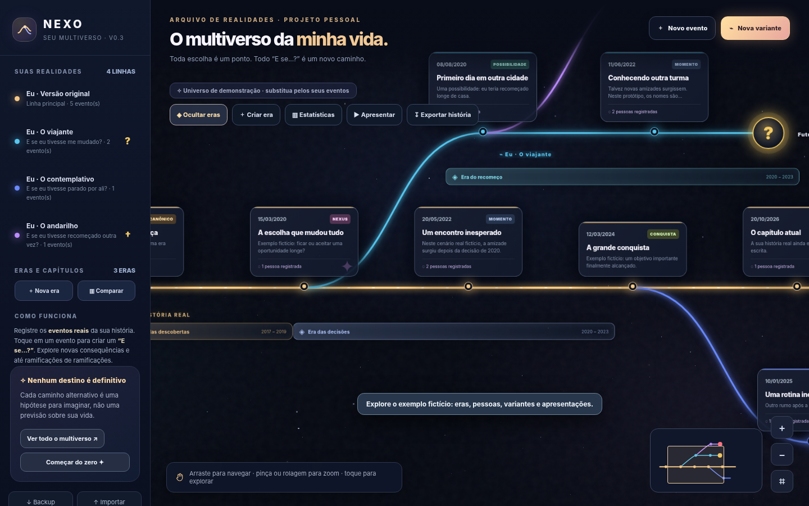
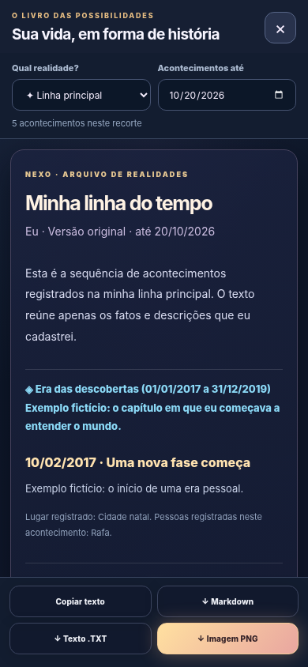
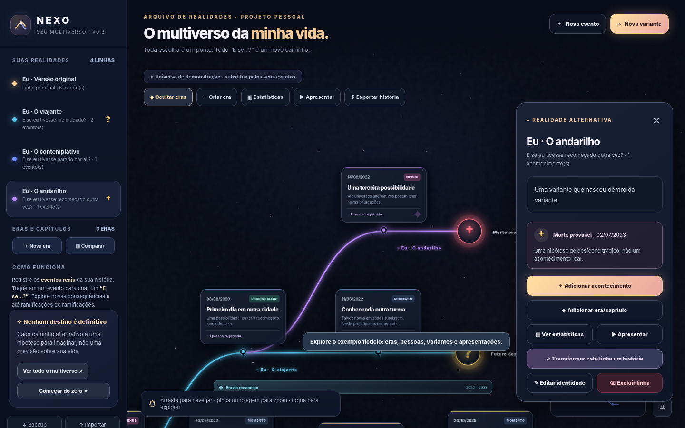

# NEXO — Your Personal Multiverse

**NEXO** is a personal, local-first, interactive timeline for exploring your real life and the paths you *might* have taken. Your real history is the golden primary timeline; alternative realities branch from specific recorded events.

> NEXO is a creative, reflective tool. Alternative events, potential deaths, and hypothetical outcomes are **not scientific predictions, facts, or diagnoses**.



## Features

- **Interactive timelines:** pan with a mouse or finger, zoom with a mouse wheel or pinch, and navigate with the minimap.
- **The main timeline:** record events, dates, descriptions, places, people you met, achievements, canonical moments, and Nexus events.
- **Alternative realities:** create branches from any event, including branches of branches. Each branch has its own title, persona, description, and editable color.
- **Named chapters:** create date-range eras (for example, "High School Years") and show or hide their overlays.
- **Reality Observatory:** compare manually recorded people, locations, achievements, and milestones with the main timeline at the **same date**.
- **Slideshow mode:** watch a selected timeline unfold chronologically, with manual or timed progression.
- **Timeline endings (new in v0.3.0):** mark a branch as unfinished (`?` in yellow), a hypothetical death (`†` in red), or a closed scenario (`■` in purple), or keep it open. Customize the date and explanation.
- **Fixed color swatches (new in v0.3.0):** select a clearly named color (blue, purple, red, yellow, and more) rather than using an arbitrary RGB picker.
- **Story export (new in v0.3.0):** turn the main timeline or a selected variant into a chronological narrative with recorded chapters, descriptions, branching decisions, and endings; copy it or download **TXT**, **Markdown**, or a shareable **PNG** image.
- **Local backups:** export your entire timeline as JSON and restore it later. Previous NEXO v0.1/v0.2 JSON data formats are accepted by this version.



## Start using NEXO

No installation, build pipeline, account, API key, or external dependencies are required.

1. Open `index.html` in a modern browser.
2. Explore the fictional sample timeline to learn how branching works.
3. Click **Começar do zero** ("Start from scratch") to create your own history (export a backup first if you want to preserve the demo).
4. Add an event to the main timeline, then create a branch using **"What if...?"**.
5. Open a branch's **Editar identidade** ("Edit identity") action to set its persona, color, and optional ending.
6. Choose **Exportar história** ("Export story") in the toolbar to preview or export the narrative for any reality.

The app interface is currently in **Brazilian Portuguese (pt-BR)**. This README is in English to make the repository easier to maintain and share.

## Important rule: how branches inherit the past

A branch inherits only events that belong to its **ancestor path up to (and including) the event where the branch started**. It does not automatically inherit later main-timeline events.

For example, if you met someone in 2020 but a variant diverged in 2010, that friend is **not automatically recorded** in the new reality. You can manually add people and outcomes to that variant. This does not mean that a person could never appear in that scenario; it simply reflects what you have recorded.

Nested variants work the same way: they inherit their own parent's history only up to the latest divergence.

## How the ending markers work

| Marker | Status | Meaning |
| --- | --- | --- |
| Yellow `?` | Unknown future | Your imagination stops here, without assuming a particular outcome. |
| Red `†` | Probable death | You have chosen to mark death as a *hypothetical* outcome of this scenario. |
| Purple `■` | Closed path | The imagined scenario has an explicit ending. |
| No terminal marker | Open path | The alternate timeline remains open to further exploration. |



End markers are **per-branch metadata**, not real-world events. Their date must be on or after the latest event recorded directly in that branch. You can reopen or edit a branch later. Branch color does not determine its ending type.

## How narrative exports work

1. Click **Exportar história** in the toolbar, or open a reality and select **Transformar esta linha em história**.
2. Choose a reality and the date up to which you want to narrate (today by default).
3. Read the preview. Save TXT or Markdown for editable text, or PNG for a long, shareable story card.

The exported narrative uses only information stored in your timeline; **it does not call an AI, invent events, or infer life outcomes**. Events after the selected cut-off date do not appear. Very long stories may exceed the maximum size of a single PNG; in that case use TXT or Markdown.

## GitHub Pages deployment

This repository is a static site. Its deployment entry point is **`index.html` in the repository root**.

1. Create a repository (suggested name: `nexo-personal-multiverse`).
2. Upload the files in the archive to the **root** of the repository (not into a nested ZIP folder), or clone the repository and commit the files.
3. Navigate to **Settings → Pages**.
4. Under **Build and deployment**, select **Deploy from a branch**, then branch **`main`**, directory **`/(root)`**, and save.
5. Open the Pages URL GitHub provides when the site is deployed.

GitHub Pages will publish the **application code and bundled fictional sample**. **Never commit your personal JSON backups, exports, or private life details into a public repository.**

## Privacy and data

- NEXO stores its timeline in the browser's **`localStorage`** using the key `nexo-multiverso-v1` to preserve compatibility with older versions.
- The published app is static. There is **no NEXO backend, login, analytics, third-party JavaScript dependency, or automatic cloud synchronization**.
- Data does **not** follow you to another browser or device automatically. Different origins (`file://`, your Pages URL, or another domain) can have separate browser storage.
- Clearing site data, using private browsing, or switching domains may make your local records unavailable. **Make regular JSON backups and import them when switching origins.**
- Browser storage is **not encrypted**. Do not use shared or untrusted devices for sensitive personal information.

## Project structure

```text
index.html                 # Complete static application (HTML + CSS + JavaScript)
README.md                  # Documentation (English)
CHANGELOG.md               # Version history
RELEASE_NOTES_v0.3.0.md    # Notes for the GitHub Release
.gitignore                 # Prevents accidental inclusion of personal exports
SECURITY.md                # Local data and privacy guidance
docs/screenshots/          # Screenshots of fictional demo data only
```

## Development and versioning

NEXO follows [Semantic Versioning](https://semver.org/) starting with `v0.3.0`, while it remains a pre-1.0 experimental personal app. The local data format remains backward-compatible; changing application code does not require deleting existing records.

Recommended commit message:

```text
feat: add terminal timeline markers and narrative exports
```

Recommended release tag: `v0.3.0`.

To create the tag **after** committing the release:

```bash
git tag -a v0.3.0 -m "NEXO v0.3.0 — Endings and Story Export"
git push origin main
git push origin v0.3.0
```

If a tag already exists, do not overwrite it; choose the correct next version instead.

## Known limitations

- No artificial intelligence or automated prediction of alternate outcomes.
- No account, remote synchronization, or collaborative timeline editing.
- PNG export creates a single tall image; exceptionally long stories should be exported as TXT or Markdown.
- Personal timeline data is stored per browser origin, not inside the HTML file itself.

## License

No open-source license has been included automatically. The repository owner may add one if they want to grant reuse permissions to others.
